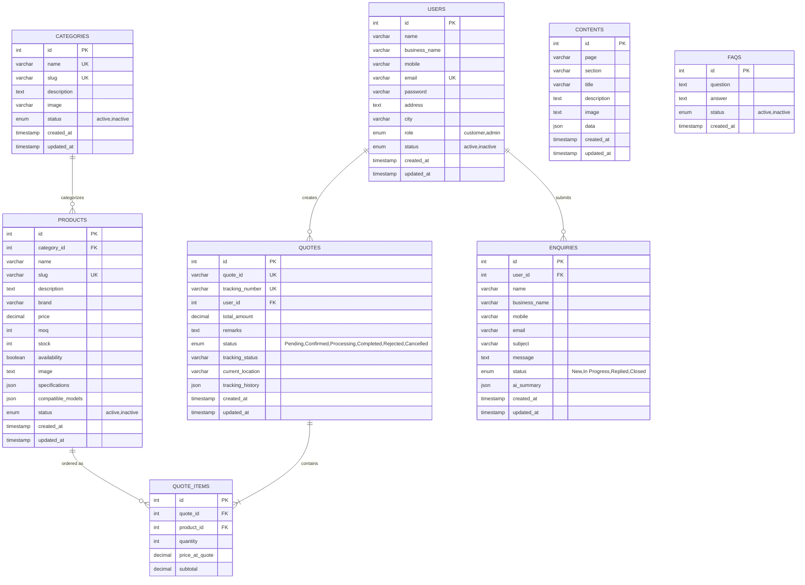

# Relational Database Schema Documentation

## Database Engine: MySQL Server 8.0.46
**Database Name**: `roshani_traders`

---

### Entity Relationship (ER) Diagram

---

### Table Specifications

#### 1. `users`
- `id` (INT, AUTO_INCREMENT, PRIMARY KEY)
- `name` (VARCHAR(255), NOT NULL)
- `business_name` (VARCHAR(255), NOT NULL)
- `mobile` (VARCHAR(50), NOT NULL)
- `email` (VARCHAR(255), NOT NULL, UNIQUE KEY)
- `password` (VARCHAR(255), NOT NULL) - *Bcrypt Hashed*
- `address` (TEXT, NULL)
- `city` (VARCHAR(100), NULL)
- `role` (ENUM('customer', 'admin'), DEFAULT 'customer')
- `status` (ENUM('active', 'inactive'), DEFAULT 'active')
- `created_at` (TIMESTAMP, DEFAULT CURRENT_TIMESTAMP)
- `updated_at` (TIMESTAMP, ON UPDATE CURRENT_TIMESTAMP)

#### 2. `categories`
- `id` (INT, AUTO_INCREMENT, PRIMARY KEY)
- `name` (VARCHAR(255), NOT NULL, UNIQUE KEY)
- `slug` (VARCHAR(255), NOT NULL, UNIQUE KEY)
- `description` (TEXT, NULL)
- `image` (VARCHAR(500), NULL)
- `status` (ENUM('active', 'inactive'), DEFAULT 'active')
- `created_at`, `updated_at`

#### 3. `products`
- `id` (INT, AUTO_INCREMENT, PRIMARY KEY)
- `category_id` (INT, NOT NULL, FOREIGN KEY -> `categories.id` ON DELETE RESTRICT)
- `name` (VARCHAR(255), NOT NULL)
- `slug` (VARCHAR(255), NOT NULL, UNIQUE KEY)
- `description` (TEXT, NULL)
- `brand` (VARCHAR(100), DEFAULT 'Roshani Genuine')
- `price` (DECIMAL(10, 2), NOT NULL, DEFAULT 0.00)
- `moq` (INT, NOT NULL, DEFAULT 10)
- `stock` (INT, NOT NULL, DEFAULT 100)
- `availability` (TINYINT(1), NOT NULL, DEFAULT 1)
- `image` (TEXT, NULL)
- `specifications` (JSON, NULL)
- `compatible_models` (JSON, NULL)
- `status` (ENUM('active', 'inactive'), DEFAULT 'active')
- Indexes: `idx_products_category_id`, `idx_products_brand`, `idx_products_status`, `idx_products_name`

#### 4. `quotes`
- `id` (INT, AUTO_INCREMENT, PRIMARY KEY)
- `quote_id` (VARCHAR(50), NOT NULL, UNIQUE KEY)
- `tracking_number` (VARCHAR(100), NOT NULL, UNIQUE KEY)
- `user_id` (INT, NOT NULL, FOREIGN KEY -> `users.id` ON DELETE CASCADE)
- `total_amount` (DECIMAL(12, 2), NOT NULL, DEFAULT 0.00)
- `remarks` (TEXT, NULL)
- `status` (ENUM('Pending', 'Confirmed', 'Processing', 'Completed', 'Rejected', 'Cancelled'), DEFAULT 'Pending')
- `tracking_status` (VARCHAR(100), DEFAULT 'Order Placed')
- `current_location` (VARCHAR(255), DEFAULT 'Roshani Central Godown, Bhiwandi, MH')
- `tracking_history` (JSON, NULL)
- `created_at`, `updated_at`

#### 5. `quote_items`
- `id` (INT, AUTO_INCREMENT, PRIMARY KEY)
- `quote_id` (INT, NOT NULL, FOREIGN KEY -> `quotes.id` ON DELETE CASCADE)
- `product_id` (INT, NOT NULL, FOREIGN KEY -> `products.id` ON DELETE CASCADE)
- `quantity` (INT, NOT NULL, DEFAULT 1)
- `price_at_quote` (DECIMAL(10, 2), NOT NULL, DEFAULT 0.00)
- `subtotal` (DECIMAL(12, 2), NOT NULL, DEFAULT 0.00)

#### 6. `enquiries`
- `id` (INT, AUTO_INCREMENT, PRIMARY KEY)
- `user_id` (INT, NULL, FOREIGN KEY -> `users.id` ON DELETE SET NULL)
- `name`, `business_name`, `mobile`, `email`, `subject`, `message`
- `status` (VARCHAR(50), DEFAULT 'New')
- `ai_summary` (JSON, NULL)
- `created_at`, `updated_at`

#### 7. `contents`
- `id` (INT, AUTO_INCREMENT, PRIMARY KEY)
- `page` (VARCHAR(100), NOT NULL)
- `section` (VARCHAR(100), NOT NULL, DEFAULT 'main')
- `title`, `description`, `image`, `data` (JSON)
- `UNIQUE KEY uk_page_section (page, section)`

#### 8. `faqs`
- `id` (INT, AUTO_INCREMENT, PRIMARY KEY)
- `question` (TEXT, NOT NULL)
- `answer` (TEXT, NOT NULL)
- `status` (VARCHAR(50), DEFAULT 'active')
- `created_at`
